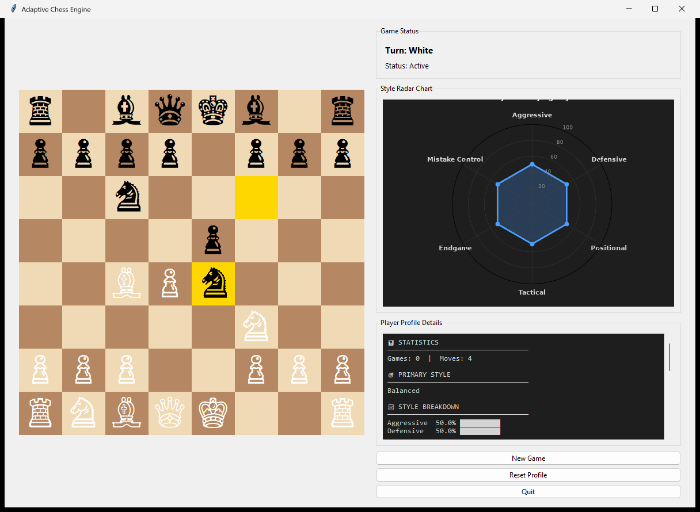

# Adaptive Chess Engine

A from-scratch Python chess engine that watches how you play and re-weights its own evaluation function to counter your style, instead of offering fixed difficulty levels.

## What it is

An academic project I built at IIT Bombay. You play against the engine in a Tkinter GUI. While you play, it classifies your moves (captures, checks, central squares, attacking vs. defensive value), builds a persistent profile of you as aggressive / defensive / tactical / positional, and shifts the weights of its evaluation function in response. A radar chart in the GUI shows your current style profile and updates as the game goes on.

Everything chess-related — board, move generation, search, evaluation — is written by hand; there's no `python-chess` underneath.



*The Tkinter GUI a few moves into a game: board on the left, live style radar chart and player profile on the right.*

## What I did

**Engine core (`engine/`)**
- `board.py`: 8x8 array board with FEN load/save, castling rights, en passant, promotion, check detection and `make_move` / `unmake_move`.
- `movegen.py`: pseudo-legal generation per piece, then legality filtering. Castling checks that the king isn't in check and doesn't pass through attacked squares.
- `search.py`: minimax with alpha-beta pruning, MVV-LVA-style move ordering, a killer-move heuristic, and a quiescence search on captures (max 3 extra plies) to soften the horizon effect. Default depth is 4.
- `evaluation.py`: a weighted sum of material, piece activity, king safety, central control, pawn structure, piece coordination, mobility and a "trade preference" term. The weights live in a dict so they can be changed at runtime — that's the hook the adaptive part uses.

**Adaptive layer (`adaptive_logic/`)**
- `style_analyzer.py` scores each of your moves and, every few moves (once at least 5 are recorded, using the last 10), updates your profile.
- `weight_adapter.py` maps your dominant style to weight deltas. For example, against an aggressive player it adds +0.3 to king safety and -0.3 to trade preference; against a defensive player it pushes central control and piece activity up. Secondary tendencies (trade willingness, king-safety focus, centre preference) fine-tune on top, and weights are clamped at zero.

**Profiles and GUI**
- `player_profile/` stores profiles both as JSON (`profiles/`) and in SQLite (`profiles.db`). After each game the SQLite profile is blended 70% old / 30% new so one odd game doesn't swing it too much.
- `gui/chess_gui.py` is the board UI; `gui/radar_chart.py` embeds a matplotlib radar chart (aggressive, defensive, positional, tactical, endgame, mistake control) inside Tkinter.

**Bug-fixing pass.** After the first version I went back and fixed several real bugs: white pieces were rendering as black (both branches of a condition returned the black glyph), `unmake_move` wasn't restoring castling rights / en passant target / halfmove clock (which silently corrupted positions during search), and the style analyzer was doing an O(n^2) `moves.index` lookup inside a loop.

## What I learnt

- **`unmake_move` is where engines quietly break.** Search makes and unmakes thousands of moves; if any piece of state isn't restored, the engine plays plausible-looking but wrong chess and nothing crashes. I only caught it by reasoning about castling rights after a search. Next time I'd write a perft test (count nodes to depth N from known positions) on day one.
- **Hand-tuned weight deltas are a heuristic, not learning.** The "adaptation" is a rule table mapping style to +/- weight changes. It's interpretable, which I like, but I have no measurement showing it actually makes the engine harder to beat for a given player. A proper next step would be self-play or logged games to test whether the adapted weights score better than the defaults.
- **Declaring isn't implementing.** `search.py` sets up a transposition table and a history table, but only the killer-move table is actually used. Adding real Zobrist hashing + TT lookups is the obvious speed win.
- **Keep one source of truth.** Profiles are saved to JSON *and* SQLite, with slightly different fields. It works, but it was me bolting the radar chart feature on later rather than designing storage once.
- **Python is slow for search.** Depth 4 is fine, depth 6 gets sluggish, and the search runs on the GUI thread so the window can freeze while the engine thinks. A background thread (or bitboards in a faster language) would help.
- Docs drift: my earlier README claimed "no external dependencies" when the radar chart needs matplotlib and numpy. Writing docs from the code, not from memory, matters.

**Known limitations:** no threefold-repetition or fifty-move-rule detection, no opening book or endgame tablebases, and the evaluation is still fairly basic.

## Repo structure

```
Chess_Bot/
├── engine/            board.py, movegen.py, search.py, evaluation.py
├── adaptive_logic/    style_analyzer.py, weight_adapter.py, adaptive_engine.py
├── player_profile/    player_profile.py, profile_manager.py (JSON), database.py (SQLite)
├── gui/               chess_gui.py (Tkinter), radar_chart.py (matplotlib)
├── docs/              ARCHITECTURE.md, ADAPTIVE_LEARNING.md
├── main.py            entry point (CLI args below)
├── demo_radar_chart.py  standalone radar chart demo
├── Makefile           run / check / test / clean shortcuts
├── QUICK_START.md, RADAR_CHART_INTEGRATION.md
└── requirements.txt
```

More detail: [docs/ARCHITECTURE.md](docs/ARCHITECTURE.md), [docs/ADAPTIVE_LEARNING.md](docs/ADAPTIVE_LEARNING.md), [RADAR_CHART_INTEGRATION.md](RADAR_CHART_INTEGRATION.md).

## How to run

Requires Python 3.7+ with Tkinter (bundled with most Python installs).

```bash
pip install -r requirements.txt
python main.py
python main.py --player-id alice --player-name "Alice" --depth 5
```

Options: `--player-id` (default `default_player`), `--player-name` (default `Player`), `--depth` (default `4`; higher is stronger but slower).

With `make` available: `make` / `make run`, `make run PLAYER_ID=alice DEPTH=5`, `make check` (syntax check), `make test` (basic board/movegen smoke tests), `make clean-profiles` (reset learned profiles). The Makefile calls `python3`; on Windows use `python main.py` directly.

**Playing:** click a piece, then its destination. Watch the style panel and radar chart change as you play; "New Game" keeps your profile.
